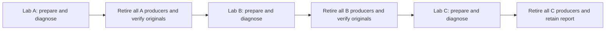

# Experimental laboratory diagnostics

These contributor APIs prepare and run one fixed diagnostic case through the
[activated attempt](provenance-acquisition-attempt.md), and sequence three
independent laboratories. They are
outside the browser distribution. Imports perform no I/O. Native use requires
separate authority, admitted inputs and the [laboratory's complete host/tool
premises](provenance-acquisition-lab.md#domain-and-process-ownership). Valid
JSON, a local test or a computed hash provides none of that admission.

Read the input contract first, then the preparation owners and retained results.
The exterior owners control order, polling/cutoffs, preservation and complete
laboratory retirement. These APIs neither provide a generic executor nor allow
another case to start from a transport-close observation.

## Closed diagnostic inputs

`copyLabDiagnosticPlan(input)` copies and freezes ordinary closed data, bounded
by the laboratory's 32KiB canonical profile limit. No path, digest, operation
identity, credential or resource budget is discovered or selected implicitly.

| Field | Domain |
| --- | --- |
| `schemaVersion`, `sourceRevision` | `1` and the lowercase40hex admitted source revision |
| `operations` | Exactly `A`, `B`, `C`, each a different lowercase32hex token |
| `image` | Exact local `sha256:<64hex>` ImageID, absolute `nodePath`, expected `nodeSha256`, `configSha256`, and `archive` with path, device/inode identity, bytes and SHA256 |
| `launcherFiles` | Exactly the five files in `LAB_LAUNCH_FILES`, each with independent expected byte length and SHA256 |
| `credentials` | Numeric nonzero uint32 `uid`, `gid`, and an increasing unique group array including the primary GID; the launcher profile owns this domain |
| `timing` | Decimal millisecond-aligned `deadlineNs`, `workUntilNs`, `observeUntilNs`, `processBudgetNs`; positive timer-safe `holdMs`, `descendantMs`, `pollMs`, `closeWaitMs`, and the existing process heartbeat/peer/TERM/KILL/close timing |
| `evidenceRefs` | `authorizationRef`, `inputEvidenceSha256`, `toolEvidenceSha256`, `clockEvidenceSha256`; independent references, not attestations created by this parser |
| `limits` | Independent positive Buffer-safe `responseBytes`, `headerBytes`, `controlBytes`, `procsBytes`, `maxProcesses` |

The case horizon is at most180s, work at most135s and process allowance at
most120s, with process < work < observation < whole horizon. Polling is at most
5000ms. The observation plus both declared close allowances fits the case
horizon. The A/B hold interval fits its process allowance; C's descendant
interval exceeds the observation horizon. These are declared diagnostic
intervals, not scheduling or speed guarantees. Overall experiment allowances
and laboratory cutoffs remain additional requirements of their owning caller.

`configSha256` identifies the JSON serialization of the inspected Config
projection. It differs from the ImageID/config-blob digest and archive digest;
none substitutes for the independent admission of image bytes or the Node
implementation. Original API bytes are retained separately. Source assets are
read from the admitted checkout and checked against their expected bytes/hash;
the source revision's syntax alone does not identify a checkout.

## Literal diagnostic programs

`labDiagnosticProgram(kind,nodePath,timing)` constructs fixed Node arguments
and literal oracles. A emits stdout `[0,65,255,10]`, stderr `[254,0,66,13]` and
exits0 after the declared hold. B emits the same bytes and exits7. C emits that
prefix and launches one finite descendant retaining stdout/stderr beyond the
declared observation horizon. The parent exits0 after its hold. Child
environment and arguments are explicit; no network, arbitrary user script or
unbounded repetition is selected.

Exit7 is the expected program result for B. It is not a successful capture or
evidence that infrastructure/cleanup succeeded. C's emitted prefix is not a
complete capture or proof that its descendant ended. Retain those distinctions
in any consumer of these oracles.

## Private files and FIFO helper

`LabCaseFiles` consumes the caller's already copied laboratory/diagnostic inputs
and trusted finite-test ports. It exclusively creates one protected case path
below the laboratory scratch, with separate `input` and `ipc` directories.
Directory traversal within that path uses retained descriptors. Source paths
and later mount observations still depend on the admitted absence of competing
privileged replacement.

The prepared Python3.11 helper `provenance_case_fifo.py` receives bounded UTF8
JSON through stdin and the expected virtual-environment prefix. Its three fixed
names are stdout/stderr/control. It verifies the expected root descriptor,
creates each FIFO once, observes its identity, sets root ownership/declared
group and0660 mode through the retained FIFO descriptor, verifies it again,
and closes once. The root is root-owned, in that group, mode0750. Partial
creations, first failure and uncertain closes remain in its closed JSON result;
there is no retry, replacement or deletion. Native use occurs inside the
laboratory's work domain, through its identified prepared interpreter.

Only the fixed five-file launcher closure and `profile.json` go into readonly
container inputs. The guard profile stays in the protected evidence root,
outside the mounted inputs. The evidence root is independently rechecked
before nine exclusive ordinary files are allocated: daemon/program stdout and
stderr, launch control, header, progress, supervisor and watchdog. Payload,
control and record capacities come from their existing owners. Truncated
length is a logical reservation, not physical storage reservation or written
extent. No tail or zero padding determines a confirmed prefix.

Files/asset identities and capacities are retained before use. Failed
preparation preserves its partial metadata once, without overwriting another
candidate; failed preservation stays explicit. The caller retains the shared
handle owner, including any late or failed close. Preparation does not remove
scratch, discard originals or settle pending native work.

## Docker preparation and profile composition

`LabDiagnosticDocker` uses the caller's immutable copied inputs, fixed private
socket and owned HTTP transactions. It reads the exact admitted archive,
checks identity/size/hash and unchanged metadata, then loads those bytes once.
There is no pull, build, tag resolution or automatic retry. It checks load
JSONL errors, the single expected local image and its inspected configuration.
Unexpected inherited environment values, volumes, exposed ports or enabled
healthchecks reject. Loading can have partial effects even if its response fails.

Create uses a unique name and explicit linux/amd64 platform, numeric credentials,
private PID (`PidMode: ""`), cgroup namespace, no application networking,
readonly rootfs, no capabilities/privilege, no-new-privileges and explicit
no-restart/no-autoremove/no-Docker-init settings. The input bind is readonly;
the FIFO bind permits the required writes. Both use prepared existing paths,
rprivate and NonRecursive; no host checkout, socket, credentials or evidence
directory is mounted. Config, HostConfig, binds, runtime Path/Args and stopped
state are checked before Start. Group membership is a set, not daemon/kernel
array order. The recipe does not invent a host-TimeNS API field.

Requests and full or partial responses have separate originals, counts and
hashes. Create requires201; load/list/inspect require200. A warning or changed
configuration fails conservatively. Duplicate decoded JSON keys reject before
parsing can erase an earlier value: the existing Exec parser
and these consumers share that grammar, retaining their own diagnostic families.
The nine fixed HTTP slots retain late-response visibility even after an earlier
close observation. Cancellation never restores permission, and a response can
reopen locally pending closure. Snapshot payloads are metadata, with explicit
collection/preservation owned by the caller.

`buildLabCaseProfiles` composes the observed objects into existing launch,
capture, activation, placement and S/W/guard inputs. It uses the launch/record
codecs and exact Exec request recipe, not parallel implementations of those
protocols. Operation, T0, container, case hierarchy, profile and header hashes
remain linked. Placement explicitly selects the accepted conditional monotonic
policy; previous strict consumers remain unchanged.

The container objects and original outcomes remain owned until complete
laboratory retirement. API completion, join, Running=false or case frozen/empty
does not exclude a producer outside that case. `nativeEffect` and
`nativeRetirement` remain unknown; global qualification flags are not upgraded.
Retaining an object also proves no closure. A consumer must preserve uncertainty
and exclude further admission whenever the required producer-domain evidence
is missing.

## One case and its ending

`LabDiagnosticCase` is owned by the verified laboratory worker. It loads the
identified archive, observes one fresh case T0, requires the full case horizon
before the laboratory's retirement reserve, prepares files and a stopped
container, and composes the existing startup and activated attempt. There is
one control/attempt selection, no retry, and cancellation transfers to owners
returned late by a trusted factory. Native Docker work, source/FIFO preparation
and result preservation remain separately owned and observable.

The private result keeps placement originals, metadata and nine independently
confirmed prefixes. Record bytes already have their own originals, so the
attempt metadata replaces duplicate collected Buffers with content hashes.
It does not infer prefix length from reserved file size. Complete preparation,
expected diagnostic behavior, local joins and exterior retirement are distinct
facts.

A requires successful capture, placement and the two literal binary oracles.
B requires those prefixes, the observed exit7 in Exec and launch X/E records,
closed launcher descriptors and no launcher cleanup failure. Its capture
failure remains a failure in the original result. C requires its prefix,
placement, the guard's original deadline result and frozen/empty observation.
Neither B nor C upgrades capture to success. The aggregate control failure
that records an expected controller/deadline ending remains visible; the join
check independently requires closed transports/FIFO/stores, settled guard,
closed successful S/W children, actor-local closure, closed native host handles
and a complete associated record. Other cleanup errors or pending work reject.
These are conservative source classifiers to be exercised by the native
experiment, not established native outcomes.

Revocation clears the placement owner's current `executionObserved` permission.
For expected negative endings, the diagnostic separately retains the earlier
identified init/launcher/program observations and R/S bindings. It matches
container namespace PIDs to launch records and the observed host parent chain;
host and container PIDs are different domains. Only a STOPPED placement ending
permits that historical projection. It does not restore permission or conceal
an identity, clock, protocol or cleanup failure.

The worker publishes the case result and original references, then remains
inside the producer domain until exterior retirement. A case sample cannot
settle the daemon that remains outside that case. `caseRetirement` remains
unknown even when a diagnostic matches its expectation.

## Three independent laboratories

`copyLabExperimentPlan(input)` admits only closed syntax, not operational
authority. Its fields are:

| Field | Domain |
| --- | --- |
| `schemaVersion`, `context` | `1`; `{operationId,sourceRevision,deadlineNs}`, one distinct32hex parent token,40hex source and positive millisecond-aligned duration within the timer domain |
| `diagnostic` | `{path,sha256}` for the independently admitted canonical diagnostic plan |
| `labs` | Exactly `A`, `B`, `C`, each a complete laboratory input plan selecting that case and the same diagnostic reference/source/tools/versions |
| `limits` | Explicit positive `pollMs` and `closeWaitMs`, polling no larger than close wait and close wait no larger than each laboratory's retirement allowance |

The three laboratory tokens, three case tokens and parent token are all
distinct. Prepared immutable tools/source/image are reused as expected inputs
and verified by each laboratory. Existing scratch/evidence anchors may be
shared, but distinct exclusive children, services, daemon/data/socket,
container, FIFO, profiles and evidence prefixes belong to each case. Different
mutable anchors must be disjoint; no alias or nested laboratory child permits
reuse. Complete retirement is required before another laboratory is selected.

`createLabExperiment(plan,ports?)` is inert until `run()`. It samples one parent
T0 before diagnostic input reading. The declared total allowance exceeds all
three complete laboratory budgets plus the close allowance. Before each
selection the remaining time must fit that laboratory's entire budget and
the close allowance. A fresh inner T0 never renews the parent's cutoff.
Polling, the total timer and cancellation revoke the current bootstrap; every
unit retains its own manager backstop. A held or late operation remains owned,
blocks further laboratories and can make final preservation incomplete.
No universal physical deadline follows from JavaScript timers.

Advancement requires the complete existing exterior lifecycle: successful input
observation/handle cleanup, expected diagnostic, keeper-frozen then work-empty
originals, exact owned whole-unit kill and forced result, readback/preservation,
collected registration and no pending/uncertain local ownership. Start's
historical `effectState=unknown` remains unchanged; it is not substituted for
the later whole-domain observations. Unknown or failed retirement stops the
sequence even with a new token; unattempted cases remain unattempted.

The first successfully observed input candidate supplies the evidence anchor
for one exclusive private experiment report. It includes plans and full
observations, then is read back and closed. If that root was not admitted,
there is no fallback path or fabricated receipt. `summary()` alone projects
closed states/codes and the report hash, excluding paths, argv, operational
configuration, payloads and native error text. There is no automatic upload.
All qualification flags remain `unqualified`.

This independent partition avoids relying on a still-live daemon's absence of
future production between cases. It repeats preparation and retains separate
storage/originals; the cost has no measured magnitude. Reusing a live daemon
would require an independently supported exclusion of future production,
not just a closed HTTP request, Promise, CLI exit or frozen/empty case.

## Controls and claims

Finite Node controls exercise byte oracles, nonzero result, native-shaped
image/create/inspect differences, independent capacities, partial preservation,
late response ownership, profile/ready bindings, logical reserves, three actual
bootstrap/exterior owners under finite ports, total/individual budget pressure,
retirement-gated selection, reentrant cancellation and private summary fields. The Python
helper controls use finite descriptor calls and verify partial failures and
once-only close, without creating FIFO or probing Linux. Ordinary files and
finite Node children do not qualify an image, container, kernel, cgroup,
resource reservation, physical closure, retention channel, CI mechanism,
signature or release. No timing, RSS or hardware claim follows.
